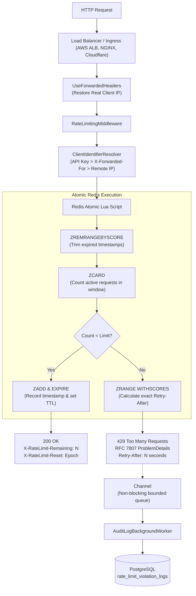

## LINK: https://rateguard-dirq.onrender.com

# Distributed Rate-Limiter & Request-Throttling Web API (Production Ready)

A high-performance, enterprise-grade ASP.NET Core Web API implementing distributed rate limiting and request throttling using **Redis** (atomic sliding-window Lua script) and **PostgreSQL** (Entity Framework Core audit persistence).

---

## Architecture & Algorithm

### Distributed Sliding-Window Algorithm
Unlike naive fixed-window counters that suffer from burst spikes at window boundaries, this service implements a **sliding-window counter** powered by Redis Sorted Sets (`ZSET`) and executed via an atomic Lua script:



---

## Production Deployment Checklist: Issues to Resolve Before Deploying

Before deploying this service to Kubernetes, AWS ECS, Azure App Service, or a production VM, review these 5 critical items:

| # | Production Concern | Why It's Critical | How This Project Solves It |
|---|---|---|---|
| **1** | **Database Credentials** | Hardcoding passwords in `appsettings.json` causes auth failures (like the local `28P01` error) and is a security risk. | Injected via environment variables (`ConnectionStrings__PostgreSql`, `Redis__ConnectionString`). Template in `.env.example`. |
| **2** | **Multi-Replica Race Conditions** | If 5 API replicas start simultaneously and run `EnsureCreatedAsync()`, they clash on table locks. | Controlled via `ApplyMigrationsOnStartup` (disabled by default in production). Idempotent DDL script provided in `scripts/init-db.sql`. |
| **3** | **Client IP Detection Behind Proxies** | Cloudflare / AWS ALB terminate TLS. Without forwarded headers, all traffic appears from the Load Balancer IP (`10.0.0.1`), throttled together. | `ForwardedHeadersOptions` configured in `Program.cs` to restore true client IP from `X-Forwarded-For`. |
| **4** | **Container Security (Non-Root)** | Running containers as `root` violates enterprise SOC2 / PCI-DSS compliance. | `Dockerfile` uses non-root user `USER $APP_UID` on hardened ASP.NET runtime. |
| **5** | **Liveness & Readiness Probes** | Orchestrators need to know when an instance is alive vs ready to receive user traffic. | `/health/live` and `/health/ready` endpoints configured and exempted from rate limits. |

---

## Environment Variables Configuration

Copy `.env.example` to `.env` or inject into your cloud secrets manager:

```bash
# Core Mode (Set to false for real Redis + PostgreSQL)
UseInMemoryFallback=false

# PostgreSQL Connection String
ConnectionStrings__PostgreSql=Host=postgres-host;Port=5432;Database=ratelimitdb;Username=postgres;Password=YOUR_STRONG_PASSWORD;SSL Mode=Require;

# Redis Connection String
Redis__ConnectionString=redis-host:6379,password=YOUR_REDIS_PASSWORD,ssl=True,abortConnect=False
Redis__KeyPrefix=ratelimit:prod:

# Rate Limits
RateLimiting__DefaultPermitLimit=10
RateLimiting__DefaultWindowSeconds=60

# Production API Keys & Tier Mapping
RateLimiting__ApiKeyTiers__partner_token_standard=Standard
RateLimiting__ApiKeyTiers__enterprise_token_vip=Premium
```

---

## Production Database Schema Setup

Run the idempotent migration script before spinning up API instances:

```bash
psql -h <host> -U <user> -d ratelimitdb -f scripts/init-db.sql
```

This creates the `rate_limit_violation_logs` table and high-performance B-tree indexes on `(ClientKey, TimestampUtc)`.

---

## Health Checks for Orchestrators

- **Liveness Probe**: `GET /health/live` (Returns `200 OK` if the process is alive).
- **Readiness Probe**: `GET /health/ready` (Returns `200 OK` if dependencies are healthy).
- *Both health check paths bypass the rate limiter completely.*

---

## Running with Docker Compose

To run the complete production-style stack locally:

```bash
docker-compose up -d --build
```

Verify service status:
```bash
docker-compose ps
```

---

## Automated CI/CD Pipeline

A production-ready GitHub Actions workflow is provided at [`.github/workflows/ci-cd.yml`](.github/workflows/ci-cd.yml):
1. Restores packages across solutions.
2. Compiles in `Release` configuration.
3. Executes all 15 unit and integration tests.
4. Builds and validates the production Docker container.

